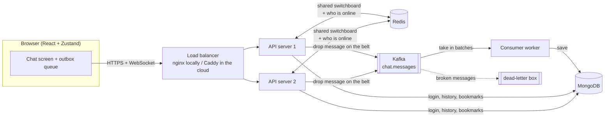
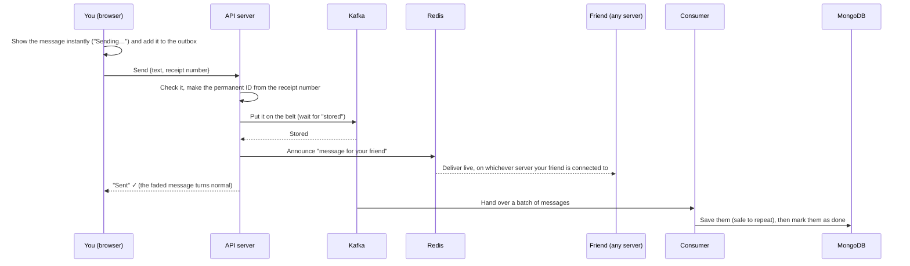

# Distributed Real-Time Messaging Architecture

**ChitChat** is a chat app (like a tiny WhatsApp) built to answer one question:

> *What does it take to make a chat service work when thousands of people use it at the same time, on more than one server, on bad internet — without losing or duplicating a single message?*

It is a personal project. The chat screen is simple on purpose; the interesting part is everything **behind** it.

**Live demo:** https://8-234-97-46.sslip.io
It runs on a Google Cloud VM that is **switched on only when needed** (to save money), so the link may be offline. See [Pause and resume](#pause-and-resume-to-save-money).

**Built with:** Node.js · Express · Socket.io (WebSockets) · Redis · Apache Kafka · MongoDB · React · Zustand · Tailwind CSS · Docker · Google Cloud

---

## Contents

1. [What you can do in the app](#what-you-can-do-in-the-app)
2. [The problems, and how each one is solved](#the-problems-and-how-each-one-is-solved)
3. [How the pieces fit together](#how-the-pieces-fit-together)
4. [What happens when you press "send"](#what-happens-when-you-press-send)
5. [What each technology does](#what-each-technology-does)
6. [Run it on your computer](#run-it-on-your-computer)
7. [Tests](#tests)
8. [Load test: how much can it take?](#load-test-how-much-can-it-take)
9. [Deploy on Google Cloud](#deploy-on-google-cloud)
10. [Security](#security)
11. [Problems I hit and how I fixed them](#problems-i-hit-and-how-i-fixed-them)
12. [Design decisions and trade-offs](#design-decisions-and-trade-offs)
13. [Known limitations](#known-limitations)
14. [Folder tour](#folder-tour)
15. [Glossary](#glossary)

---

## What you can do in the app

- **Sign up and log in** with a username and password.
- **Chat in real time.** A message appears on the other person's screen instantly, with no page refresh.
- **See who is online** (the green dot) and **who is typing** ("typing…").
- **Use several tabs or devices** at once. Everything stays in sync.
- **Get unread badges** ("3" next to a name). They survive a page refresh.
- **Scroll up to load older messages.** Only the latest 30 are loaded first, so big chats open fast.
- **Send on a bad connection.** Your message shows up immediately as *Sending…*. If the network drops, the app keeps trying. If it finally can't, the message turns red with **Retry** and **Delete** buttons.
- **Use it on a phone.** On a small screen you see either the chat list or the chat, with a back arrow.

---

## The problems, and how each one is solved

Each problem below is a real one that every chat service faces. Each has a plain-language explanation and the tool used to solve it.

### 1. "How does a message arrive instantly?" → WebSockets

A normal web page works like **checking your letterbox**: you go and look, and most of the time it is empty. To get "instant" messages that way, the browser would have to ask the server *"anything new?"* many times a second. That wastes a lot of work.

A **WebSocket** works like **a phone call that stays open**. The server can speak to you the moment something happens. So when someone sends you a message, the server pushes it straight down that open line.

### 2. "What if one server isn't enough?" → Redis

One server can only hold so many open "phone calls". So you run **several servers** behind a load balancer. This creates a new problem:

> Alice is connected to **Server 1**. Bob is connected to **Server 2**. Alice sends Bob a message. Server 1 has no idea Bob exists — he is on Server 2!

**Redis** acts as a **shared switchboard** that all servers listen to. Server 1 announces *"message for Bob"*; Server 2 hears it and delivers it. (This pattern is called *Pub/Sub*: one side publishes, the others subscribe.)

Redis also keeps the **"who is online"** list shared between servers. Each server regularly "checks in" for its users. If a server crashes, its users stop being refreshed and disappear from the list by themselves after about 45 seconds, instead of showing as online forever.

### 3. "What if the database is slow or down?" → Kafka

Saving every message straight into the database means the database sets the speed of the whole chat. If it gets busy or hiccups, users wait or lose messages.

**Kafka** is like a **conveyor belt in a post-office sorting room**:

1. The server drops the message onto the belt. Kafka confirms it is safely stored. Only then is the sender told *"sent"*.
2. A separate worker (the **consumer**) takes messages off the belt in batches and writes them to the database.

So if the database is slow, the belt just fills up for a while and nothing is lost. If the worker crashes, the messages wait on the belt until it is back. Messages from the same chat always stay on the same lane of the belt, so they stay **in order**.

Messages that are broken or unreadable go to a separate **"dead letter" box** instead of blocking the belt.

### 4. "What if the internet is bad?" → Optimistic UI and an outbox

When you press send, the app **does not wait** for the server. It shows your message immediately (a little faded, with *Sending…*) and puts it in an **outbox**. A small worker in your browser delivers the outbox in the background:

- **In order**, one message at a time per chat.
- **With retries.** If it fails, it waits 1 second, then 2, then 4… (this is called *exponential backoff*) and tries again, up to 5 times.
- **When your connection returns**, failed messages are retried automatically.
- If the server **rejects** the message (for example it is empty), it fails right away and shows **Retry / Delete**.

### 5. "What if a retry sends the message twice?" → Idempotency

Imagine the server received your message, but the confirmation got lost on the way back. Your app thinks it failed and retries. Without protection, the receiver would see the same message twice.

The fix is a **receipt number**. Every message gets a unique ID made in your browser. The server turns that ID into the message's permanent ID, so **the same receipt always gives the same message**. If the server sees it again, it simply says *"already got it"* and does not deliver it a second time. (Computer scientists call this being **idempotent**: doing it twice has the same effect as doing it once.)

This one idea protects every step: the sender's retries, Kafka's possible duplicates, and the database writes.

### 6. Smaller problems

| Problem | Solution |
|---|---|
| "How do I know what I haven't read?" | The server keeps a **bookmark** per chat (the time of the last message you saw). Unread = messages after the bookmark. Because it lives on the server, it works on every device and survives a refresh. |
| "Loading a huge chat is slow." | **Pagination:** load 30 messages at a time, using the last message you have as the starting point for the next page. |
| "Typing indicators would flood the system." | They are tiny temporary signals that pass through Redis and are **never saved**. They are also limited: the browser sends at most one every 2 seconds, and the server ignores floods. |
| "Someone could pretend to be me on the live connection." | The WebSocket checks the same secure login cookie as the rest of the app. (This was a real hole in the first version; see [Problems I hit](#problems-i-hit-and-how-i-fixed-them).) |

---

## How the pieces fit together



**In one sentence:** the servers are interchangeable (they remember nothing), Redis connects them for live delivery, Kafka protects the saving of messages, and MongoDB is the permanent memory.

---

## What happens when you press "send"



Notice that your friend sees the message **before** it is in the database. That is fine: it is on the belt, which is safe. The app keeps recent messages in memory for a minute so that reloading the chat in that tiny gap doesn't make a message vanish.

---

## What each technology does

| Technology | Job in this project | Plain-language role |
|---|---|---|
| **Node.js + Express** | The API server (login, send, history, unread) | The "front desk" that handles requests |
| **Socket.io (WebSockets)** | Live connection to each browser | The phone line that stays open |
| **Redis** | Cross-server messaging, online list, "have I seen this message before?" | The shared switchboard and noticeboard |
| **Apache Kafka** | Buffer between the API and the database | The conveyor belt |
| **MongoDB (Atlas)** | Users, messages, read bookmarks | The permanent filing cabinet |
| **React** | The screens | What you see |
| **Zustand** | The app's memory in the browser (messages, outbox, unread…) | The browser-side notebook |
| **Tailwind CSS + daisyUI** | Styling | The paint |
| **Docker + Docker Compose** | Runs all the parts together with one command | A shipping container for the whole system |
| **nginx / Caddy** | Load balancer; Caddy also gives free HTTPS | The traffic director |
| **Google Cloud (Compute Engine)** | Hosts the live demo | The rented computer |

---

## Run it on your computer

You need **Node.js 20+** and a free **MongoDB Atlas** database (or any MongoDB).

### Option A: simple (no Docker, one server)

This is the easiest. Redis and Kafka are optional, so without them the app runs in a simpler single-server mode.

```bash
# 1. get the code and install
npm install
npm install --prefix frontend

# 2. create your settings file
cp .env.example .env
#    then open .env and fill in MONGO_DB_URI and JWT_SECRET (any long random text)

# 3. start the API (port 5000) and, in a second terminal, the website (port 3000)
npm run server
npm run dev --prefix frontend
```

Open http://localhost:3000, sign up two users in two different browsers, and chat.

### Option B: the full system (2 servers + Redis + Kafka + consumer), with Docker

```bash
docker compose build app1     # builds the app image once (all services share it)
docker compose up -d          # starts Redis, Kafka, the consumer, 2 API servers and nginx
```

Open http://localhost:8080. The two API servers are also on ports 5001 and 5002, which lets the tests put one user on each server.

To run **three** consumers at once (they share the work): `docker compose up -d --scale consumer=3`.

### Settings (`.env`)

| Setting | Needed? | What it is |
|---|---|---|
| `MONGO_DB_URI` | yes | Your MongoDB connection string. If the password has special characters like `@`, they must be URL-encoded (`@` becomes `%40`). |
| `JWT_SECRET` | yes | A long random text used to sign login tokens. Keep it secret. |
| `PORT` | no | Defaults to 5000. |
| `NODE_ENV` | no | Set to `production` when serving over HTTPS (makes the login cookie `Secure`). |
| `REDIS_URL` | no | Turns on multi-server mode. |
| `KAFKA_BROKERS` | no | Turns on the Kafka write path (and you then run `npm run consumer` too). |

---

## Tests

There are **130 automated checks**. They run against **real** servers and a real database, not pretend ones. The only fake part is in the outbox unit test, which fakes just the network so it can make it fail on purpose. Test users are named `zztest_…` and are deleted when the test ends.

```bash
npm run test:unit      # 27 checks  – the browser-side logic (outbox queue, store). No server needed.
npm run test:api       # 68 checks  – login, sending, sockets, duplicates, pages, unread. Needs a running server.
npm run test:stack     # 35 checks  – needs `docker compose up -d`. Servers, Redis and Kafka failures.
npm run test:cleanup   # removes leftover test users if a run was interrupted
```

To run the API tests against another address: `BASE_URL=http://localhost:8080 npm run test:api`

**The failure tests are the interesting ones.** They deliberately break things:

| What I break | What is checked |
|---|---|
| Put Alice on server 1 and Bob on server 2 | Messages, typing and online status still cross between them |
| Kill a server with users on it | Its users disappear from "online" after ~45 s; a clean shutdown removes them instantly |
| Stop the Kafka consumer | Sending still works and friends still get messages live; after restarting, every message is saved **once and in order** |
| Kill the consumer in the middle of 60 messages | Exactly 60 messages in the database. None lost, none doubled |
| Stop Kafka completely | The API says "unavailable" within ~6 s (never a false "sent"); after recovery the retry is saved exactly once |
| Feed Kafka broken messages | They go to the dead-letter box and the next good message still works |

---

## Load test: how much can it take?

```bash
USERS=100 MESSAGES=30 THINK_MS=100 npm run load
```

It creates many fake users, each holding a live connection and sending messages to a partner. It measures how fast things are and checks that **nothing was lost or duplicated**, both on the live path and in the database.

Results on **one laptop** (the load generator, 2 servers, Redis, Kafka, the consumer and nginx all competing for the same CPU; the database was remote on Atlas). Treat the numbers as *relative*, not as real-world capacity:

| Users | Messages per user | Messages/second | API latency (typical / slow 5%) | Lost | Duplicated | Saved in database |
|---:|---:|---:|---|---:|---:|---:|
| 40 | 25 | 146 | 22 ms / 78 ms | 0 | 0 | 1000 / 1000 |
| 100 | 30 | 328 | 122 ms / 244 ms | 0 | 0 | 3000 / 3000 |
| 200 | 20 | 402 | 251 ms / 1480 ms | 0 | 0 | 4000 / 4000 |

**How to read this:** as more users pile on, each message takes longer (latency rises) and the speed levels off near 400 messages per second. That is where this one laptop ran out of CPU. The important result is the last columns: **nothing was lost or duplicated at any load.** I did not profile what exactly the bottleneck is.

The same test over the internet against the live demo (30 users, 600 messages, from a laptop to a server in Mumbai): all delivered and saved, none lost or doubled, typical API latency 92 ms.

---

## Deploy on Google Cloud

The whole system runs on **one** Google Cloud VM using Docker Compose, with a free HTTPS address (`<ip>.sslip.io`, a name that automatically points to the server's IP, so no domain purchase is needed). Caddy handles the HTTPS certificate automatically. Only ports 22, 80 and 443 are open to the internet; Kafka, Redis and the API servers are not reachable from outside.

```bash
bash deploy/gcp-setup.sh   # once: creates the project, firewall, fixed IP and VM
                           #       (then add the printed IP in MongoDB Atlas -> Network Access)
bash deploy/deploy.sh      # copies the latest commit to the VM and starts everything
```

Run these in **Git Bash** from the project folder, with the `gcloud` tool installed and logged in.

### Pause and resume to save money

A cloud VM costs money while it runs, so this project can be switched off and on:

| Command | What it does | Cost while off | Coming back |
|---|---|---|---|
| *(automatic)* | The VM **shuts itself down** after 30 minutes with nobody connected (and never in the first 15 minutes after starting) | about $10/month (disk + reserved IP) | `bash deploy/resume.sh`, about 1 minute, same URL |
| `bash deploy/stop.sh` | Stops the VM right now | about $10/month | same |
| `bash deploy/pause.sh` | **Full pause:** saves the disk as a snapshot, then deletes the VM, disk and IP | **pennies** | `bash deploy/resume.sh`, about 2–4 minutes |

`resume.sh` is the only command you need to remember: it works from every state. After a full pause the server may get a **new IP address**. The script prints it and copies it to the clipboard, and you add it in MongoDB Atlas under *Network Access* (Atlas only accepts connections from IPs you allow). If Google gives back the same IP, nothing changes.

I tested all of this on the real VM: it stayed on while a user was connected, shut itself down about 4 minutes after the last user left (with a shortened 2-minute test limit), and a full pause followed by a resume brought the site back with all tests passing.

The prices above are approximate; check the Google Cloud pricing calculator for exact current numbers.

---

## Security

- **Passwords** are hashed with bcrypt, never stored as plain text.
- **Login** uses a token in a cookie that JavaScript cannot read (`httpOnly`), is only sent to this site (`SameSite=Strict`), and is `Secure` (HTTPS only) in production.
- **The live WebSocket connection is authenticated** with that same cookie. The server never trusts a user ID sent by the browser.
- **Input is checked on the server:** usernames, passwords, message length, IDs. Objects like `{"$ne": null}`, a trick used to fool databases (*NoSQL injection*), are rejected.
- **Brute-force protection:** limited login and signup attempts.
- **Standard security headers** (`helmet`) and a size limit on requests.
- The server **refuses to start** without its required secrets.
- The deployed VM has its **own, separately generated secret** that never leaves the machine.

---

## Problems I hit and how I fixed them

This is the part I learned the most from.

| What went wrong | How it showed up | The fix |
|---|---|---|
| **The live connection trusted a user ID sent by the browser** | Anyone could connect pretending to be someone else and read their incoming messages | The WebSocket now checks the secure login cookie. There is a test where an attacker claims another user's ID and receives nothing. |
| **Messages from other people appeared in the wrong chat** | If you were talking to Amit and Priya wrote, her message showed up in your chat with Amit | Messages are shown only in the chat they belong to; other chats get an unread badge. |
| **Sending a message to yourself broke data** | It could land in a random other conversation | Rejected by the server. |
| **An outage took 45 seconds to report** | With Kafka stopped, sending hung for 45 s before failing | A hard 6-second limit, then a clear "unavailable" so the app can retry. |
| **The consumer took 27 s to recover after Kafka restarted** | A flaky test exposed it; nothing was lost, but it was slow | Tuned the consumer's timeouts: it now resumes in 7–10 s. |
| **Every request hit the database just to look up the user** | Latency was higher than it should be | A 30-second memory cache: throughput rose from about 87 to 240+ messages/second in my test. |
| **A test I wrote could never fail** | A "page size is capped at 100" check passed with only 75 messages | Rewritten to create 120 messages first. A test that can't fail proves nothing. |

---

## Design decisions and trade-offs

Every choice has a cost. Here is what I chose and what it costs.

| Decision | Why | The cost |
|---|---|---|
| **WebSocket only** (no fallback to polling) | No "sticky" load-balancer settings needed | A client that can't open a WebSocket can't connect |
| **Kafka between the API and the database** | The "sent" confirmation does not wait for the database; spikes and short database problems are absorbed | More moving parts; a message is deliverable a few milliseconds before it is readable from the database (covered by the in-memory cache). At this project's size, writing directly would also work, which is why a direct mode is kept. |
| **ID made from the receipt number** | Retried messages can never duplicate | Receipt numbers must be unique per sender (the browser uses a random UUID) |
| **No special "exactly-once" Kafka mode** | Duplicates are harmless because saving is repeat-safe, and sends can run in parallel | Duplicate events can exist on the belt |
| **Consumer saves first, then marks "done"** | A crash re-delivers instead of losing | Needs the repeat-safe saving above |
| **Bookmark per chat instead of "read" flags per message** | Marking a chat read is one tiny write | No per-message "seen" ticks |
| **30-second user cache** | Removes a database read from every request | A deleted user could keep access for up to 30 s |
| **One VM, not a cluster** | Cheap, simple, easy to switch off | Not truly production-grade availability |

---

## Known limitations

This is an honest list of what it is **not**:

- Kafka and Redis each run as a **single copy** (no backup copy), which is fine for a demo but not for production durability.
- Everyone registered appears in everyone's contact list. There are no friends or contacts yet.
- Login rate limiting is counted per server, in memory.
- No message editing or deleting, images/files, group chats, or end-to-end encryption.
- Messages still in the outbox are lost if you refresh the page before they are sent.
- The load test numbers come from one laptop, not a real production environment.

---

## Folder tour

```
backend/
  server.js              starts the API; security, health check, graceful shutdown
  socket/socket.js       live connections: login check, Redis link, rooms, online status, typing
  socket/presence.js     the "who is online" list (Redis version and in-memory version)
  kafka/                 Kafka setup and the producer used by the API
  consumer.js            the separate worker that moves messages from Kafka to MongoDB
  controllers/           the logic behind each URL (login, send, history, unread…)
  routes/  models/  middleware/
frontend/src/
  utils/outbox.js        the send queue: order, retries, receipt numbers
  utils/readState.js     unread counts and "read up to here" bookmarks
  zustand/               the browser-side store
  components/  hooks/  pages/  context/
tests/                   unit, API, failure (Redis/Kafka) and load tests
deploy/                  Google Cloud scripts: set up, deploy, pause/resume, idle shutdown, HTTPS
Dockerfile  docker-compose.yml  nginx.conf
```

---

## Glossary

- **API** – the part of the server that answers requests such as "log me in" or "send this message".
- **WebSocket** – a connection that stays open so the server can send data at any time.
- **Redis** – a very fast in-memory data store; used here as a shared switchboard and noticeboard.
- **Pub/Sub** – "publish/subscribe": one side announces, any number of others listen.
- **Kafka** – a system that stores a stream of messages safely in order so other programs can read them at their own pace.
- **Producer / Consumer** – the program that puts messages on Kafka / the one that reads them off.
- **Dead-letter queue** – a side box for messages that could not be processed.
- **MongoDB / Atlas** – the database / its cloud-hosted service.
- **Idempotent** – doing something twice has the same result as doing it once (safe to retry).
- **Optimistic UI** – showing the result right away and fixing it later if it fails.
- **Exponential backoff** – waiting longer after each failed attempt (1 s, 2 s, 4 s…).
- **Horizontal scaling** – handling more load by adding more servers instead of one bigger server.
- **Load balancer** – spreads incoming connections across several servers.
- **JWT** – a signed token that proves who you are after logging in.
- **Docker / Docker Compose** – packages programs so they run the same everywhere / starts several at once.
- **HTTPS** – the secure (encrypted) version of the web.
