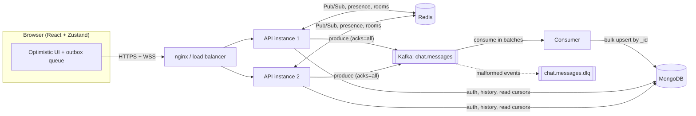
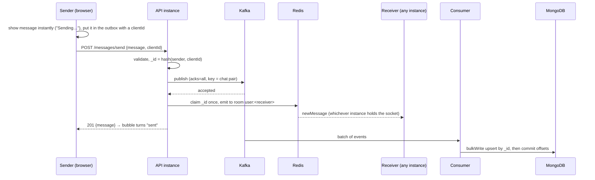

# ChitChat — distributed real-time messaging

A real-time chat app built to explore the problems that appear when a chat service has to scale beyond one server:
persistent WebSocket connections, fan-out across instances, durable buffering of writes, and a client that feels instant
even on a bad network.

**Stack:** Node.js · Express · Socket.io (WebSockets) · Redis Pub/Sub · Apache Kafka · MongoDB · React · Zustand · Tailwind/daisyUI · Docker

**Live demo:** https://8-234-97-46.sslip.io — runs on a GCP VM that is **started on demand and shuts itself down when idle**
to save cost, so the link may be offline (see [Deploy on GCP](#deploy-on-gcp) for how it is started).

## Architecture



### What happens when you press send



## Features

- **Real time** over WebSockets: messages, typing indicators, online presence, multi-tab/multi-device
- **Horizontal scaling**: any number of stateless API instances; Redis Pub/Sub adapter fans events out across them
- **Kafka write buffer**: the API acknowledges once Kafka has the message; a separate consumer persists to MongoDB in
  batches, so traffic spikes and short database hiccups don't hit users
- **Optimistic UI + client queue**: messages appear instantly, are delivered in order with retry/backoff, and survive
  flaky networks without ever creating duplicates
- **Persistent unread counts** (server-side read cursors) and **cursor pagination** with infinite scroll
- **Auth**: JWT in an httpOnly SameSite=Strict cookie, also used to authenticate WebSockets; bcrypt; rate-limited login
- Works without Redis/Kafka too (single-process mode) for local development

## Design decisions and trade-offs

| Decision | Why | Trade-off |
|---|---|---|
| **WebSocket-only transport** (no long-polling fallback) | No sticky sessions needed behind a load balancer | Clients that can't open a WebSocket can't connect |
| **Redis adapter + per-user rooms** (`user:<id>`) | "Send to user" works across all of a user's tabs on *any* instance | Redis becomes a dependency of the real-time path |
| **Presence = Redis sorted set with heartbeat scores** | A crashed instance's users expire by themselves (~45 s) instead of staying "online" forever | Presence is eventually consistent for up to the TTL after a hard crash; graceful shutdown clears it immediately |
| **Kafka between API and MongoDB** | The ack depends on Kafka, not on the database; consumer batches writes; the log can be replayed | A message is deliverable a few ms before it is readable from history (the client keeps recent messages for 60 s to cover the gap); more moving parts. At this project's scale writing straight to MongoDB would also work — direct mode is kept for that reason |
| **Deterministic `_id` = hash(senderId, clientId)** | A retried send maps to the *same* document, so every step (publish, consumer upsert, live delivery claim) is idempotent | `clientId` must be unique per sender (the client uses a UUID) |
| **No broker-level idempotent producer** | Duplicates from producer retries are harmless because the consumer upserts by `_id`; sends can run in parallel | Duplicate events can exist in the topic |
| **Consumer commits offsets only after MongoDB has the data** | At-least-once: a crash re-delivers, never loses | Needs the idempotent upsert above |
| **Dead-letter topic** | One malformed event can't block a partition | Someone has to look at the DLQ |
| **Read cursors, not per-message "read" flags** | Marking a chat read is one tiny write; unread = count of messages newer than the cursor | Counts are per chat partner (no per-message receipts) |
| **Cursor pagination on `(createdAt, _id)`** | Stable under inserts; messages sharing a millisecond are never skipped | |
| **30 s cache of the authenticated user** | Removed a database round trip from every request (big latency win) | A deleted user keeps access for up to 30 s |

## Run it

### Quick start (no Docker, single process)

```bash
cp .env.example .env            # set MONGO_DB_URI and JWT_SECRET
npm install && npm install --prefix frontend
npm run server                  # API + sockets on :5000
npm run dev --prefix frontend   # client on :3000 (proxies /api and /socket.io to :5000)
```

### Full stack (2 API instances + Redis + Kafka + consumer + nginx)

```bash
docker compose up --build       # then open http://localhost:8080
```

The two API instances are also published on `:5001` and `:5002` so tests can pin users to a specific instance;
Kafka is reachable from the host on `localhost:9094`. The consumer can be scaled:
`docker compose up -d --scale consumer=3` (partitions are shared between the instances of the consumer group).

### Environment

| Variable | Required | Purpose |
|---|---|---|
| `MONGO_DB_URI` | yes | MongoDB connection string (URL-encode special characters in the password) |
| `JWT_SECRET` | yes | signs session tokens |
| `PORT`, `NODE_ENV` | no | `NODE_ENV=production` makes the cookie `Secure` (use behind HTTPS) |
| `REDIS_URL` | no | enables cross-instance Pub/Sub + shared presence |
| `KAFKA_BROKERS` | no | enables the Kafka write path (run `npm run consumer` as a separate process) |
| `CLIENT_ORIGIN` | no | extra allowed socket origins when the client is served from elsewhere |

## Testing

All tests run against **real** servers and a real database (no mocks except the client-queue unit test, which mocks
only the network). Test users are created with a `zztest_` prefix and deleted afterwards; `npm run test:cleanup`
removes leftovers from an interrupted run.

```bash
npm run test:unit      # client store + outbox queue                              (27 checks, no server needed)
npm run test:api       # REST + sockets, idempotency, pagination, unread          (68 checks, needs a running server)
                       #   BASE_URL=http://localhost:8080 npm run test:api  to run it against the full stack
docker compose up -d && npm run test:stack
                       # cross-instance delivery, instance crash, Kafka failures  (35 checks)
```

What the stack tests cover:

- user A on instance 1, user B on instance 2: messages, typing and presence cross instances
- hard-kill an API instance → its users disappear from presence after the TTL; graceful stop clears them immediately
- **stop the consumer** → sends are still accepted and delivered live; nothing reaches MongoDB; after restart all messages
  are persisted once and in order
- **kill the consumer mid-burst** → exactly the right number of messages in MongoDB (none lost, none duplicated)
- **stop Kafka** → the API answers `503` within ~6 s (never a false "sent"); the client retries after recovery and the
  message is stored exactly once
- malformed events land in the dead-letter topic and don't block the partition

### Load test

```bash
USERS=100 MESSAGES=30 THINK_MS=100 npm run load
```

Each simulated user holds a WebSocket and sends messages to a partner at a steady pace. It measures API latency,
end-to-end delivery latency (sender → receiver's socket) and verifies nothing was lost or duplicated, live or in MongoDB.

Measured on a **single laptop** (Windows, Docker Desktop), everything on the same machine — 2 API instances, Redis,
single-broker Kafka, the consumer, nginx and the load generator itself — with MongoDB on a remote Atlas cluster. Treat the numbers as
relative, not as production capacity:

| Users | Msgs/user | Think time | Throughput (msg/s) | API latency p50 / p95 / p99 | Delivery p50 / p95 | Lost / duplicated | In MongoDB |
|---:|---:|---:|---:|---|---|---:|---:|
| 40 | 25 | 200 ms | 146 | 22 / 78 / 527 ms | 28 / 92 ms | 0 / 0 | 1000 / 1000 |
| 100 | 30 | 100 ms | 328 | 122 / 244 / 1490 ms | 173 / 322 ms | 0 / 0 | 3000 / 3000 |
| 200 | 20 | 50 ms | 402 | 251 / 1480 / 3753 ms | 354 / 1494 ms | 0 / 0 | 4000 / 4000 |

Latency grows with load while throughput flattens near ~400 msg/s — the point where this one machine (load generator included)
runs out of CPU. Correctness did not degrade: no message was lost or duplicated at any level. I have not profiled the exact bottleneck.

## Deploy on GCP

The whole stack (2 API instances, Redis, Kafka, consumer, Caddy) runs with Docker Compose on a single Compute Engine VM.
Caddy terminates HTTPS with an automatic Let's Encrypt certificate for `<ip>.sslip.io` (a free hostname that resolves
to the reserved static IP — no domain needed), and only ports 22/80/443 are open. MongoDB stays on Atlas.

```bash
bash deploy/gcp-setup.sh   # once: new project, firewall, static IP, VM  (then add the printed IP to Atlas -> Network Access)
bash deploy/deploy.sh      # ship the last commit and start the stack (JWT_SECRET is generated on the VM)
bash deploy/resume.sh      # ONE command to bring it back from any state (~1 min if just stopped, ~4 min if fully paused)
bash deploy/stop.sh        # stop the VM now (cheap pause: the disk and static IP still cost ~$10/month)
bash deploy/pause.sh       # FULL pause: snapshot, then delete VM + disk + IP (~pennies/month). resume.sh rebuilds it
```

After a full pause the app comes back with a **new IP and URL**, and the new IP must be added in Atlas -> Network Access
(`resume.sh` prints it and copies it to the clipboard).

**Cost control:** a systemd timer on the VM checks every minute how many WebSockets are open (`/healthz`). With none for
30 minutes — and never within 15 minutes of boot — the VM shuts itself down, which stops compute billing. Only the disk
and the reserved IP keep costing a little. Verified on the real VM: it stayed up while a user was connected and stopped
itself ~4 minutes after the last disconnect when tested with a 2-minute limit.

The same suites run against the deployed site over the internet:
`BASE_URL=https://<your-host> npm run test:api` (68/68 passing) and
`SIGNUP=1 URLS=https://<your-host> USERS=30 npm run load` (600 messages: no loss, no duplicates, p50 API latency 92 ms,
measured from a laptop to a VM in Mumbai).

## Project layout

```
backend/
  server.js             Express app, security middleware, graceful shutdown
  socket/socket.js      Socket.io: JWT auth, Redis adapter, rooms, presence heartbeat, typing
  socket/presence.js    presence store (Redis sorted set / in-memory)
  kafka/                topic setup, producer (API side)
  consumer.js           Kafka -> MongoDB persister (separate process)
  controllers/ routes/ models/ middleware/
frontend/src/
  utils/outbox.js       optimistic send queue: ordering, retry/backoff, idempotency keys
  utils/readState.js    unread counts + read cursors
  zustand/              single store (conversations, messages, outbox, unread, typing)
tests/                  unit, API, stack (Redis/Kafka failure) and load tests
deploy/                 GCP scripts: VM setup, deploy, start/stop, idle auto-shutdown, Caddy (HTTPS)
Dockerfile, docker-compose.yml, nginx.conf
```

## Known limitations

- Kafka and Redis run as single nodes here (no replication) — fine for a demo, not for production durability
- The user list shows every registered user (there is no contacts/friends concept yet)
- Login/signup rate limiting is per API instance (in memory)
- No message editing/deletion, media, group chats or end-to-end encryption
- Unsent messages live in memory: a page refresh loses anything still in the outbox
